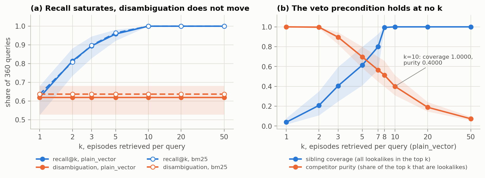
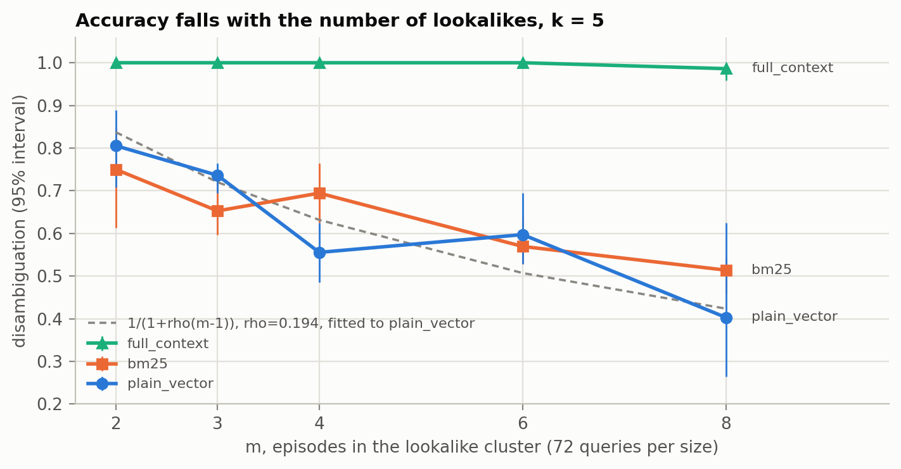
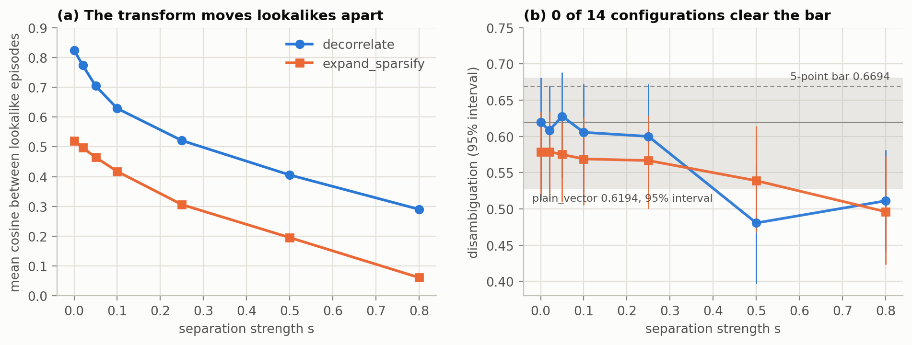
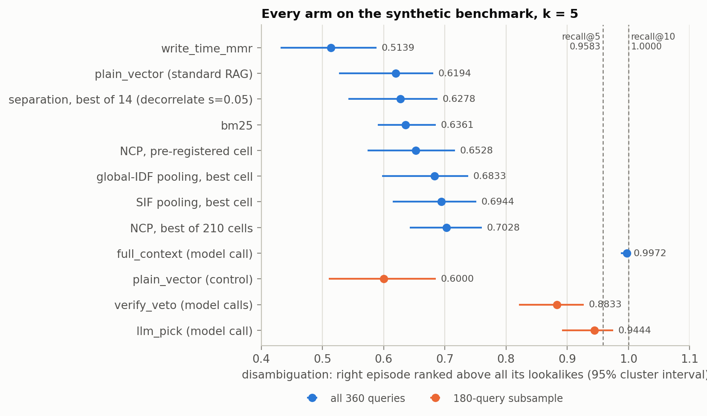
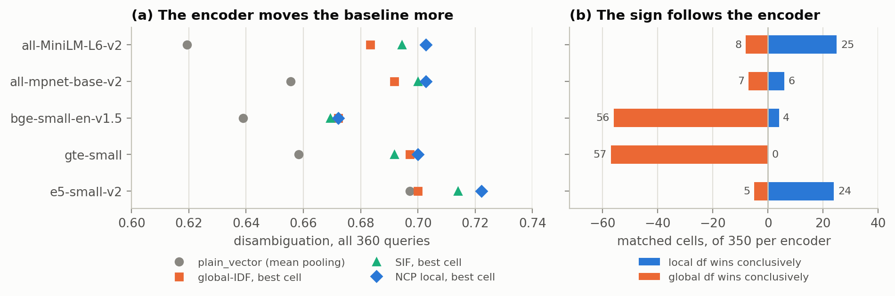
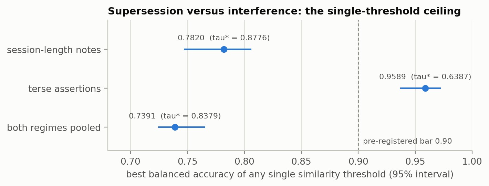

# membrain-benchmark: the measurements behind MemBrain

A benchmark and a test harness for long-term memory in AI agents. It asks one
question that the usual memory benchmarks do not: when an agent has stored
several memories that look almost the same, does it pick the right one?

The approach these measurements were made for is called **MemBrain**: agent
memory built on how human memory works, instead of on tuning retrieval. This
repository holds its measurement side: a synthetic benchmark of lookalike
episodes, the harness that ran every arm on it, the frozen result files, the
cached model responses (so the model-call arms replay offline). The paper
"MemBrain: An Agent Memory Built on the Brain, and What the Measurements Said"
is in preparation.

The part of MemBrain that survived these measurements ships as a Claude Code
plugin: [lesson-recall](https://github.com/tr4m0ryp/lesson-recall).

## The finding in one paragraph

With standard RAG (top-k similarity) on this benchmark, the right memory is in
the top 5 for 0.9583 of the queries and ranked above all of its lookalikes for
0.6194 of them. A larger k fetches the right memory every time from k = 10 on
and never changes which memory wins. The loss is competition between similar
memories, not retrieval, and that moves the work from the read path to the
write path. Every number below is copied from a file in [`results/`](./results)
and carries its setup; [`docs/figures/data.json`](./docs/figures/data.json)
names the file and JSON key of every plotted value.

## How it works, and why

### Standard RAG: a sum over the top k

Retrieval-augmented generation in its original form
([Lewis et al., NeurIPS 2020](https://arxiv.org/abs/2005.11401), Section 2)
answers an input $`x`$ by retrieving passages $`z`$ and marginalising over the
top k of them. The RAG-Sequence model is

```math
p_{\mathrm{RAG}\text{-}\mathrm{Sequence}}(y \mid x) \;\approx\; \sum_{z \,\in\, \mathrm{top}_k\left(p(\cdot \mid x)\right)} p_\eta(z \mid x) \prod_{i=1}^{N} p_\theta\left(y_i \mid x, z, y_{1:i-1}\right)
```

with a dense retriever (DPR, a two-encoder search):

```math
p_\eta(z \mid x) \;\propto\; \exp\!\left(d(z)^\top q(x)\right), \qquad d(z) = \mathrm{BERT}_d(z), \qquad q(x) = \mathrm{BERT}_q(x)
```

- $`x`$ is the input (here, a question about a past episode) and $`y = (y_1, \dots, y_N)`$ the generated answer.
- $`z`$ is one stored passage (here, one episode).
- $`p_\eta(z \mid x)`$ is the retriever: how similar the passage looks to the input.
- $`d(z)`$ and $`q(x)`$ are the passage and query embeddings; their dot product is the similarity.
- $`\mathrm{top}_k`$ keeps the k passages with the highest $`p_\eta`$ and drops the rest.
- $`p_\theta(y_i \mid x, z, y_{1:i-1})`$ is the generator: the next token given the input, one passage and the tokens so far.

### The problem sits in the top-k sum

Take the right episode $`z^\ast`$ and a lookalike $`z'`$ from the same event
family. Their relative weight inside the sum is

```math
\frac{p_\eta(z^\ast \mid x)}{p_\eta(z' \mid x)} \;=\; \exp\!\left(\big(d(z^\ast) - d(z')\big)^\top q(x)\right)
```

The ratio does not contain $`k`$. Raising k adds passages with lower scores but
never changes how $`z^\ast`$ stands against $`z'`$. Two quantities hide in the
formula; one of them depends on k and the other does not:

```math
R@k = P\left(z^\ast \in \mathrm{top}_k\right), \qquad A = P\left(z^\ast \text{ ranked above every lookalike of } z^\ast\right)
```

$`R@k`$ (recall) asks whether the right episode was fetched; $`A`$
(disambiguation) asks whether it beats its lookalikes. The benchmark below is
built to measure the gap between them.

### The benchmark

The synthetic corpus is generated by `brain.corpus.generate` (generator
`template-v1`, seed 0, similarity knob $`\sigma = 0.7`$) and frozen by content
hash (SHA-256 `25c2953a0b38dc4066e8cff99f01aa3cbd39aca6296018966b57fbde34d24ebb`,
checked on every load). It is a set of clusters of lookalike episodes:

```math
\mathcal{C} = \{c_1, \dots, c_{33}\}, \qquad |c| = m_c \in \{2, 3, 4, 6, 8\}, \qquad \#\{c : m_c = m\} = \{2{:}12,\; 3{:}8,\; 4{:}6,\; 6{:}4,\; 8{:}3\}
```

so every cluster size contributes $`m \cdot \#\{c : m_c = m\} = 24`$ episodes
and 72 queries: 120 episodes and 360 queries in total.

- **A cluster is one topic.** Each cluster draws a distinct topic (file path, subsystem, component, symptom, language, repro, signal, check) from a bank of 40, without replacement.
- **Siblings are distinct events of that topic.** Episode $`e_{c,i}`$ gets its own trigger (bank of 16), diagnosis with cause and fix (bank of 18), outcome (bank of 12, numeric slots filled per episode), date (within 240 days from 2026-01-05) and artifact (a PR number on a `fix/<symptom>-<i>` branch). Each axis is drawn without replacement inside the cluster, so no two siblings share a value on any discriminative axis.
- **Siblings read alike.** Every episode keeps $`n_{\mathrm{shared}} = 1 + \lfloor 5\sigma + 0.5 \rfloor = 5`$ of the 6 topic sentences next to its 4 discriminative sentences, and keeps the cluster's sentence order (one of 4 variants) with probability $`\sigma`$.
- **Queries cue one axis in other words.** Each episode gets 3 queries, one per cue axis (trigger, outcome, cause). A query repeats the topic fields every sibling shares and paraphrases the cue, then asks for the other two axes. The correct trace is $`e_{c,i}`$; its distractors are the other $`m_c - 1`$ episodes of the cluster.

How alike the siblings are is measured, not designed: with all-MiniLM-L6-v2
the mean cosine between siblings is 0.8243 and between non-siblings 0.3480; a
uniform pick inside the cluster scores $`\overline{1/m} = 0.275`$; and with the
cue restored to the episode's own wording a TF-IDF match disambiguates 1.0 of
the queries, so every query is answerable (src: `data/corpus/synthetic/manifest.json`).

Two relational corpora carry the write-decision experiment:
`data/corpus/relations` (v1: 290 episodes, 180 labelled pairs, 24 pair clusters) and
`data/corpus/relations-v2` (v2: 870 episodes, 540 labelled pairs, 30 pair clusters,
SHA-256 `24ff2689a02ef9ffa3d9bf4573431cef7be53d8e3413faac6dfdf63d2dbf7158`). Each
holds supersession, interference, duplicate and coincidence pairs in a
session-length regime and a terse-assertion regime.

### Metrics

An arm returns a ranked list $`L_k(q)`$ of k episode ids for query $`q`$, with
$`r(z)`$ the position of $`z`$ in it. With $`z^\ast_q`$ the correct trace and
$`S(q)`$ its siblings:

```math
R@k = \frac{1}{|Q|} \sum_{q \in Q} \mathbf{1}\big[z^\ast_q \in L_k(q)\big], \qquad A = \frac{1}{|Q|} \sum_{q \in Q} \mathbf{1}\Big[z^\ast_q \in L_k(q) \;\land\; \forall s \in S(q) : s \notin L_k(q) \lor r(z^\ast_q) < r(s)\Big]
```

- A sibling that was not retrieved ranks below a retrieved correct trace; a correct trace that was not retrieved is a miss.
- A query without siblings would leave the denominator; every query here has $`m \ge 2`$, so all 360 count.
- Every arm runs at $`k = 5`$ unless a sweep says otherwise, over seeds 0 to 4, and a query's indicator is its mean over the seeds.

Progress of a read-time picker is the share of available headroom it closes,
against a control arm and a recall ceiling $`R`$:

```math
H = \frac{A - A_{\mathrm{ctrl}}}{R - A_{\mathrm{ctrl}}}
```

Every interval is a **cluster bootstrap**: the resampling unit is the
interference cluster (33 of them), never the query, because the 360 query
indicators are 33 correlated blocks. A resample $`B^\ast`$ of clusters is scored
with the ratio estimator, the interval is bias-corrected and accelerated (BCa)
with a leave-one-cluster-out jackknife for the acceleration, at
$`B = 10000`$ resamples:

```math
\hat\theta^\ast = \frac{\sum_{c \in B^\ast} \sum_{q \in c} x_q}{\sum_{c \in B^\ast} n_c}, \qquad \mathrm{CI}_{95} = \Big[\hat\theta^\ast_{(\alpha_1)},\; \hat\theta^\ast_{(\alpha_2)}\Big], \qquad \alpha_{1,2} = \Phi\!\left(\hat z_0 + \frac{\hat z_0 + z_{0.025,\,0.975}}{1 - \hat a\,(\hat z_0 + z_{0.025,\,0.975})}\right)
```

- $`x_q`$ is query $`q`$'s seed-averaged indicator and $`n_c`$ the number of queries in cluster $`c`$ (6 to 24).
- $`\hat z_0`$ is the bias correction, $`\Phi^{-1}`$ of the share of resamples below the point estimate; $`\hat a`$ the acceleration from the jackknife.
- A difference between two arms is a **paired** interval: both arms are scored on the same resampled clusters.

Kill criteria were written before each run and are evaluated by
`brain.eval.evaluate_kill_criterion`. The write-time separation gate is
typical: a configuration survives if it beats both `plain_vector` and
`full_context` by at least 5 points of $`A`$ with non-overlapping cluster
intervals, and the baseline's accuracy falls with cluster size.

### The arms

Every arm reads the same 120 episodes, embedded once by all-MiniLM-L6-v2 (384
dimensions, 256 wordpieces, unit vectors) unless it says otherwise.

- **`plain_vector`, standard RAG (top-k similarity).** $`L_k(q) = \mathrm{top}_k\, \cos\big(e(q), e(z)\big)`$, the dense retriever above.
- **`bm25`.** BM25Okapi (rank-bm25) over alphanumeric tokens, no stemming, no stop words, $`k_1 = 1.5`$, $`b = 0.75`$:

```math
\mathrm{BM25}(q, z) = \sum_{t \in q} \mathrm{IDF}(t)\,\frac{f(t,z)\,(k_1 + 1)}{f(t,z) + k_1\left(1 - b + b\,\dfrac{|z|}{\overline{|z|}}\right)}, \qquad \mathrm{IDF}(t) = \ln\frac{n - n_t + 0.5}{n_t + 0.5}
```

  with a negative IDF replaced by $`\varepsilon \cdot \overline{\mathrm{IDF}}`$, $`\varepsilon = 0.25`$.
- **`write_time_mmr`.** Maximal marginal relevance moved to write time: each arriving vector is pushed off its nearest stored neighbour $`x_{\mathrm{nn}}`$ and stored as $`x' = \mathrm{normalize}\big(x - (1-\lambda)\langle x, x_{\mathrm{nn}}\rangle\, x_{\mathrm{nn}}\big)`$, $`\lambda = 0.5`$. The stored vectors do not move; reading is `plain_vector`.
- **`full_context`.** All 120 episodes in one prompt to claude-haiku-4-5 at temperature 0, which returns a ranking of k ids.
- **Write-time separation, `decorrelate`.** A write probes its 32 nearest stored vectors and collides with those above cosine $`\tau = 0.75`$. For each collision $`v_j`$, nearest first, with $`u_j = (x - v_j)/\lVert x - v_j\rVert`$:

```math
x \leftarrow \frac{x + s\,u_j}{\lVert x + s\,u_j \rVert}, \qquad v_j \leftarrow \frac{v_j - s\,u_j}{\lVert v_j - s\,u_j \rVert}
```

  For two unit vectors the two norms are equal, so each step is the pairwise push of Theorem 1 with one shared normaliser and strength $`2s/\lVert x - v_j\rVert`$. At $`s = 0`$ the stored bytes are untouched.
- **Write-time separation, `expand_sparsify`.** Vectors and queries are first coded as $`\phi(x) = \mathrm{normalize}\big(H_{192}(W x)\big)`$, with $`W \in \mathbb{R}^{3840 \times 384}`$ a sparse random expansion (38 inputs per unit, weights $`\pm 1/\sqrt{38}`$) and $`H_{192}`$ keeping the 192 largest-magnitude coordinates (5% active). The push above follows, then both moved codes are re-sparsified with $`H_{192}`$. The collision threshold is calibrated to the same criterion in this geometry (0.4125).
- **`llm_pick`.** One claude-haiku-4-5 call per query sees the question and all 5 `plain_vector` candidates and returns a ranking: $`L_5(q) = \mathrm{LLM}\big(q, \mathrm{top}_5(q)\big)`$.
- **`verify_veto`, the recollection veto.** One call per candidate (5 per query) sees the question and that single note, names the attribute the question keys on, and answers MATCH, MISMATCH or ABSENT. A candidate is vetoed iff the verdict is MISMATCH and the recalled value is grounded in the note (at least half of its tokens occur there). Survivors keep their base order and vetoed candidates go below.
- **NCP, neighbourhood-conditional pooling.** Each episode gets a second vector pooled from token states $`h^{(i)}_t`$ with weights conditioned on its own stored neighbourhood $`N(i)`$ (its $`k_{\mathrm{n}}`$ nearest episodes):

```math
df^{(i)}_t = \frac{\bigl|\{\, j \in N(i) : t \in x_j \,\}\bigr|}{|N(i)|}, \qquad w^{(i)}_t = \bigl(1 - df^{(i)}_t\bigr)^{\gamma}, \qquad v^{(i)}_{\mathrm{dist}} = \mathrm{normalize}\!\left(\frac{\sum_t w^{(i)}_t h^{(i)}_t}{\sum_t w^{(i)}_t}\right)
```

```math
\mathrm{score}(q, i) = \alpha \cos\!\bigl(q_{\mathrm{full}}, v^{(i)}_{\mathrm{full}}\bigr) + (1-\alpha) \cos\!\bigl(q_{\mathrm{dist}}, v^{(i)}_{\mathrm{dist}}\bigr)
```

  - $`v^{(i)}_{\mathrm{full}}`$ is the mean-pooled vector, unchanged; at $`\gamma = 0`$ the scheme is mean pooling exactly.
  - The query side is either the mean-pooled query or the query pooled with global corpus frequency at the same $`\gamma`$.
  - The grid is $`\gamma \in \{0, 0.25, 0.5, 1, 2, 4, 8\}`$, $`\alpha \in \{0, 0.25, 0.5, 0.75, 1\}`$, $`k_{\mathrm{n}} \in \{4, 8, 16\}`$; the cell $`(\gamma, \alpha, k_{\mathrm{n}}, \text{query}) = (1, 0.5, 8, \text{mean})`$ was named primary before the run.
  - Two weighted-pooling incumbents run beside it: a global-IDF arm of the same form with $`df`$ measured over the whole corpus, and SIF (Arora et al. 2017).

### Theorem 1: symmetric separation cannot reorder a colliding pair

**Premises.** Two stored vectors $`v_i, v_j`$ are pushed symmetrically (equal
and opposite moves along their difference), through one shared normaliser
$`Z > 0`$, in the same dimension the query lives in, and the competition is
between the two of them ($`m = 2`$). With $`u = (v_i - v_j)/2`$ and strength $`s \ge 0`$:

```math
v_i' = \frac{v_i + s\,u}{Z}, \qquad v_j' = \frac{v_j - s\,u}{Z} \quad\Longrightarrow\quad q^\top v_i' - q^\top v_j' = \frac{1+s}{Z}\left(q^\top v_i - q^\top v_j\right)
```

**Proof sketch.** Subtract the two lines:
$`q^\top(v_i' - v_j') = \big(q^\top(v_i - v_j) + 2s\,q^\top u\big)/Z`$, and
$`2u = v_i - v_j`$ turns the bracket into $`(1+s)\,q^\top(v_i - v_j)`$. Since
$`(1+s)/Z > 0`$, the push scales every query's score difference by a positive
constant: the margin widens and its sign, the winner, never changes.

The theorem reaches the symmetric pair. A push that moves the two members
differently, a different normaliser per vector, an expansion into another
space, or a cluster of three or more sits outside its premises. NCP sits
outside it too: it reweights tokens before pooling, with a different weight
vector per episode, so no shared normaliser exists.

### Results

Synthetic benchmark throughout unless a corpus is named: 120 episodes, 360
queries, 33 clusters, all-MiniLM-L6-v2, $`k = 5`$, seeds 0 to 4, cluster-BCa
intervals at $`B = 10000`$.

**1. Retrieval finds the memory; competition loses it.** With `plain_vector`,
$`R@5 = 0.9583`$ $`[0.9221, 0.9815]`$ and $`A = 0.6194`$ $`[0.5273, 0.6812]`$.
Sweeping $`k \in \{1, 2, 3, 5, 10, 20, 50\}`$: recall is 0.6194, 0.8139,
0.8944, 0.9583, then 1.0000 from $`k = 10`$ on, while $`A = 0.6194`$ at every
k. BM25 behaves the same: recall 0.9639 at $`k = 5`$ and 1.0000 from
$`k = 10`$, $`A = 0.6361`$ $`[0.5908, 0.6850]`$ at every k. Both arms return a
prefix of one fixed order, so a query's outcome is decided at $`k = 1`$
(src: `results/k-sweep/ksweep-20260801T184604Z.json`).

<picture>
  <source media="(prefers-color-scheme: dark)" srcset="docs/figures/png/recall-vs-k-dark.png">
  
</picture>

*Synthetic benchmark, 360 queries, plain_vector and bm25, k swept from 1 to 50
(panel b adds k = 7 and 8 from the addendum file). Shaded: 95% cluster
intervals.*

**2. The recollection veto's precondition holds at no k.** The veto needs a
bounded, enumerable competitor set: every lookalike inside the window
(sibling coverage) and the window made of lookalikes (competitor purity). For
`plain_vector` at $`k = 1, 5, 7, 8, 10`$, coverage is 0.0389, 0.6139, 0.8000,
0.9944, 1.0000 and purity 1.0000, 0.6979, 0.5653, 0.5135, 0.4000. Coverage
completes at $`k = 10`$, where purity is 0.4000; the largest cluster holds 8
episodes, so no window satisfies both. In the k-sweep files the keys
`precondition_satisfiable` and `bounded_enumerable_satisfied` record sibling
coverage being complete, nothing more (src:
`results/k-sweep/ksweep-20260801T184604Z.json`,
`results/k-sweep/ksweep-addendum-20260801T192231Z.json`).

**3. Accuracy falls with the number of lookalikes.** `plain_vector` disambiguates
0.806, 0.736, 0.556, 0.597, 0.403 of the queries at $`m = 2, 3, 4, 6, 8`$, and
the interference law $`\mathrm{Acc}(m) = 1/(1 + \rho(m-1))`$ fits with
$`\rho = 0.194429`$, maximum absolute error 0.09016. BM25 runs 0.750 to 0.514.
`full_context` stays at 1.000 up to $`m = 6`$ and 0.986 at $`m = 8`$, overall
0.9972 $`[0.9879, 1.0000]`$ (src: `results/gate-separation/gate-20260724T224755Z.json`).

<picture>
  <source media="(prefers-color-scheme: dark)" srcset="docs/figures/png/cluster-size-dark.png">
  
</picture>

*Synthetic benchmark, 72 queries per cluster size, k = 5. Bars: 95% cluster
intervals (3 clusters at m = 8, 4 at m = 6). Dashed: the law fitted to
plain_vector.*

**4. Write-time separation: 0 of 14 configurations cleared the 5-point bar.**
Both modes at seven strengths each, against `plain_vector` at 0.6194:

| $`s`$ | `decorrelate` $`A`$ [95%] | sibling cosine | $`\Delta`$ (pts) | `expand_sparsify` $`A`$ [95%] | sibling cosine | $`\Delta`$ (pts) |
|---|---|---|---|---|---|---|
| 0 | 0.6194 [0.5273, 0.6812] | 0.8243 | +0.00 | 0.5783 [0.5117, 0.6339] | 0.5201 | -4.11 |
| 0.02 | 0.6083 [0.5215, 0.6698] | 0.7735 | -1.11 | 0.5789 [0.5111, 0.6343] | 0.4971 | -4.06 |
| 0.05 | 0.6278 [0.5426, 0.6880] | 0.7043 | +0.83 | 0.5750 [0.5100, 0.6318] | 0.4648 | -4.44 |
| 0.1 | 0.6056 [0.5226, 0.6723] | 0.6289 | -1.39 | 0.5689 [0.5049, 0.6268] | 0.4176 | -5.06 |
| 0.25 | 0.6000 [0.5258, 0.6726] | 0.5211 | -1.94 | 0.5667 [0.4998, 0.6290] | 0.3062 | -5.28 |
| 0.5 | 0.4806 [0.3970, 0.5634] | 0.4057 | -13.89 | 0.5389 [0.4676, 0.6140] | 0.1956 | -8.06 |
| 0.8 | 0.5111 [0.4411, 0.5812] | 0.2903 | -10.83 | 0.4961 [0.4233, 0.5724] | 0.0613 | -12.33 |

The transform fired: at the selected cell (`decorrelate`, $`s = 0.05`$, chosen
by maximum $`A`$ on the same corpus) 82 of 120 writes separated, and sibling
cosine fell from 0.8243 to 0.2903 across the `decorrelate` sweep. The best cell
gained +0.83 points; the pre-registered $`s = 0.25`$ scored 1.94 points below
the control; BM25 at 0.6361 is above every cell. Theorem 1 shows in the data:
pair accuracy at $`m = 2`$ is 0.8056 at all seven `decorrelate` strengths, while
`expand_sparsify`, outside the premises, moves it between 0.7639 and 0.7778.
The contrast between sibling and non-sibling cosine fell from 0.4763 to 0.1053
under `decorrelate`: the push moves a vector against the whole store, not just
its cluster (src: `results/gate-separation/gate-20260724T224755Z.json`).

<picture>
  <source media="(prefers-color-scheme: dark)" srcset="docs/figures/png/separation-dark.png">
  
</picture>

*Synthetic benchmark, 360 queries, 14 configurations, k = 5. Strength and mode
were selected on the same corpus the verdict is read from, which favours the
mechanism. Shaded band: the control's 95% cluster interval.*

**5. Read-time pickers.** On a 180-query stratified subsample over all 33
clusters (5 seeds, $`k = 5`$, candidates from `plain_vector`):

| Arm | $`A`$ [95%] | Correct-item rejection [95%] | Demotion [95%] | $`H`$ at $`R = 1.0000`$ | $`H`$ at $`R = 0.958`$ |
|---|---|---|---|---|---|
| `plain_vector` (control) | 0.6000 [0.5107, 0.6852] | 0.3647 [0.2808, 0.4525] | 0.3647 [0.2778, 0.4490] | 0.0% | 0.0% |
| `llm_pick` | 0.9444 [0.8918, 0.9752] | 0.0000 [0.0000, 0.0000] | 0.0000 [0.0000, 0.0000] | 86.1% | 96.2% |
| `verify_veto` | 0.8833 [0.8214, 0.9272] | 0.0118 [0.0000, 0.0377] | 0.0647 [0.0333, 0.1074] | 70.8% | 79.1% |

`verify_veto` minus `llm_pick` is -6.11 points $`[-9.89, -3.08]`$ (paired), and
the veto rejects the correct item in 0.0118 of the queries against 0.0000, so
its kill criterion fired on both axes. The saturated ceiling $`R = 1.0000`$ is
`plain_vector` recall from $`k = 10`$ on, measured on all 360 queries; pairing
it with the subsample arms is a stated assumption. The 0.958 column uses recall
at $`k = 5`$. On the subsample itself recall at $`k = 5`$ is 0.9444, the same
value `llm_pick` reaches. Cold, a call cost 0.014243 USD for `llm_pick` and
0.012308 USD per candidate for `verify_veto`. The veto ran at $`k = 5`$, where
its precondition does not hold (result 2) (src:
`results/veto/veto-smoke-20260725T144603Z.json`,
`results/k-sweep/ksweep-addendum-20260801T192231Z.json`).

<picture>
  <source media="(prefers-color-scheme: dark)" srcset="docs/figures/png/arms-dark.png">
  
</picture>

*Synthetic benchmark, k = 5. Blue: all 360 queries. Orange: the 180-query
subsample the model-call pickers ran on, with its own control at 0.6000. Every
arm without a model call sits between 0.5139 and 0.7028; NCP and pooling rows
are best cells over their grids.*

**6. Neighbourhood-conditional pooling.** Over 320 cells and zero model calls,
on all 360 queries:

| Arm | $`A`$ [95%] | Paired $`\Delta`$, best NCP cell minus arm (pts) |
|---|---|---|
| `plain_vector` (mean pooling) | 0.6194 [0.5259, 0.6825] | +8.33 [+4.65, +12.31] |
| `bm25` | 0.6361 [0.5904, 0.6858] | +6.67 [+0.29, +12.96] |
| global-IDF, best cell | 0.6833 [0.5977, 0.7386] | +1.94 [-0.81, +5.43] |
| SIF, best cell | 0.6944 [0.6148, 0.7516] | +0.83 [-2.10, +4.42] |
| NCP, pre-registered cell | 0.6528 [0.5738, 0.7165] | |
| NCP, best of 210 cells | 0.7028 [0.6430, 0.7606] | |

The best cell clears 5 points over mean pooling and BM25; against the two
weighted-pooling incumbents the paired intervals contain zero, and the
pre-registered cell sits +3.33 points over the control. In the one-variable
ablation (70 matched cells at $`k_{\mathrm{n}} = 8`$, where the place $`df`$ is
measured is the one thing that changes), local beats global conclusively in 8 and global beats local
in 1, mean +0.27 points. Sibling pairs do reorder (up to 1104 of them), so the
mechanism acts where Theorem 1 does not reach (src:
`results/ncp/ncp-20260725T215915Z.json`).

Sweeping the encoder and $`k_{\mathrm{n}} \in \{4, 8, 16, 32, 64\}`$ (350
matched cells per encoder, 1750 in all): local wins conclusively in 59, global
in 133, and the sign follows the encoder. The encoder alone moves the
mean-pooling baseline from 0.6194 (all-MiniLM-L6-v2) to 0.6972 (e5-small-v2)
(src: `results/ncp/ncp-encoder-20260801T195813Z.json`).

| Encoder | `plain_vector` | best local | best global | best SIF | local wins | global wins |
|---|---|---|---|---|---|---|
| all-MiniLM-L6-v2 | 0.6194 | 0.7028 | 0.6833 | 0.6944 | 25 | 8 |
| all-mpnet-base-v2 | 0.6556 | 0.7028 | 0.6917 | 0.7000 | 6 | 7 |
| bge-small-en-v1.5 | 0.6389 | 0.6722 | 0.6722 | 0.6694 | 4 | 56 |
| gte-small | 0.6583 | 0.7000 | 0.6972 | 0.6917 | 0 | 57 |
| e5-small-v2 | 0.6972 | 0.7222 | 0.7000 | 0.7139 | 24 | 5 |

<picture>
  <source media="(prefers-color-scheme: dark)" srcset="docs/figures/png/ncp-encoders-dark.png">
  
</picture>

*Synthetic benchmark, 360 queries, 5 encoders by 5 neighbourhood sizes. Panel a
shows best cells, a maximum over each grid; panel b counts paired intervals that
exclude zero.*

**7. One similarity threshold cannot separate supersession from interference
in session-length text.** On relations v2, same-topic stratified (234
supersession and 2858 same-workstream interference pairs per regime), 5 seeds,
clusters resampled at $`B = 10000`$, the best balanced accuracy of any rule
that thresholds one similarity score:

```math
A^{\ast} = \max_{\tau,\,o}\; \tfrac{1}{2}\left(\mathrm{TPR}_{\tau,o} + \mathrm{TNR}_{\tau,o}\right)
```

- $`\tau`$ is the split point and $`o`$ the side labelled supersession.
- $`\mathrm{TPR}`$ is the share of supersession pairs called supersession, $`\mathrm{TNR}`$ the share of interference pairs called interference.

| Regime | $`A^\ast`$ [95%] | $`\tau^\ast`$ | Leave-one-cluster-out |
|---|---|---|---|
| Session-length notes | 0.7820 [0.7470, 0.8061] | 0.8776 | 0.7751 |
| Terse assertions | 0.9589 [0.9368, 0.9725] | 0.6387 | 0.9543 |
| Both pooled | 0.7391 [0.7241, 0.7656] | 0.8379 | 0.7274 |

In the long regime the classes overlap on $`[0.7884, 0.9698]`$, which holds
0.9316 of the supersession pairs and 0.8009 of the interference pairs. A
merge-above-threshold policy at $`\tau = 0.85`$ there destroys 1345 of 2858
distinct-event pairs (0.4706) at merge precision 0.1643 and misses 234 of 458
supersessions; in the terse regime it destroys 1 and misses 249 (src:
`results/threshold-ceiling/threshold-20260725T185408Z.json`).

<picture>
  <source media="(prefers-color-scheme: dark)" srcset="docs/figures/png/threshold-ceiling-dark.png">
  
</picture>

*Relations v2 corpus (870 episodes), same-topic stratified, 5 seeds, 95%
cluster intervals. The pooled ceiling sits below both regimes because their
optimal thresholds differ.*

**8. Consolidation.** One pass over the 120-episode store (`plain_vector`,
$`k = 5`$, complete linkage, merged records written by a model and replayed
from `data/cache/consolidate`, paired cluster intervals, before $`A = 0.6194`$), scored with the expected
convention $`c(a) = 1/(1+a)`$ for a record that absorbed $`a`$ further events:

| $`\tau`$ | Destructive (replace originals) | Non-destructive (keep originals) |
|---|---|---|
| 0.75 | -0.3021 [-0.3581, -0.2366] | +0.0121 [+0.0042, +0.0238] |
| 0.80 | -0.2629 [-0.3282, -0.1996] | +0.0103 [+0.0026, +0.0225] |
| 0.85 | -0.1455 [-0.2135, -0.0846] | +0.0089 [+0.0006, +0.0231] |
| 0.90 | -0.0486 [-0.0841, -0.0210] | +0.0028 [+0.0000, +0.0085] |

At $`\tau = 0.85`$ the destructive cell reads +0.0611 [+0.0000, +0.1238] when a
merged record earns credit for every event it absorbed, -0.1455 under the
expected convention, and -0.3028 [-0.3917, -0.2232] when it must be the
originating event. Lexical answer recall at rank 1 rises under destructive
merging (+0.2291, +0.1298, +0.0758 at $`\tau = 0.75, 0.80, 0.85`$) while
disambiguation falls (src: `results/consolidation/20260725T114045Z-consolidation_delta.json`).
On LoCoMo (10 conversations, 5880 turns, 1527 questions, primary cell
destructive at 0.85) the three conventions read +0.008, +0.007, +0.007 and
agree on 0.9987 of the queries (src:
`results/convention-external/convention-external-20260801T215836Z.json`).

**9. Shipped systems, driven through their own write paths.** Mem0 0.1.118's
`_update_memory` under a stated 0.85 cosine policy destroys 20 of 60 labelled
distinct-event pairs, 0.3333 [0.2250, 0.4375] (src:
`results/incumbents/incumbents-20260801T182900Z.json`). The full table, with
Mem0 2.0.15, graphiti-core 0.29.2, TOKI and nous-state, is in
[`results/incumbents/incumbents-20260801T182900Z.md`](./results/incumbents/incumbents-20260801T182900Z.md).

**10. Memory precision.** A model judge (binary agreement 1.0 with 36
hand-labelled assertions) found 0.9498 of 219 stored assertions from 30
transcripts entailed by their source; 0.0502 were not supported and 0.0137
were strict fabrications (src: `results/precision/memory_precision.json`).

## Install

Tested on Linux x86_64 with Python 3.12.3 in a fresh venv (3 min 19 s wall):

```bash
python3 -m venv .venv && .venv/bin/pip install -e .
.venv/bin/pip install -e '.[figures]'   # matplotlib, for docs/figures and brain.figures
.venv/bin/pip install -e '.[llm]'       # the Anthropic SDK, for a cold model-call run
```

Every direct dependency is pinned exactly in [`pyproject.toml`](./pyproject.toml).
The encoder all-MiniLM-L6-v2 downloads from Hugging Face on first use.

## Run and reproduce

**Tests** (no API key, 8 cores):

```
$ BRAIN_LLM_BACKEND=none .venv/bin/python -m pytest -q
459 passed, 2 skipped, 165 warnings in 391.46s (0:06:31)
```

**The two free arms, no model and no API key** (36 s wall):

```
$ BRAIN_LLM_BACKEND=none .venv/bin/python -m brain.eval --arms plain_vector,bm25
corpus=synthetic episodes=120 queries=360 sha=25c2953a smoke=False
plain_vector     disambig=0.6194 cluster95=[0.5273, 0.6812] seed95=[0.6194, 0.6194] seeds=[0, 1, 2, 3, 4] k=5 31.4s
                 curve m=2:0.806 m=3:0.736 m=4:0.556 m=6:0.597 m=8:0.403 | drop=0.403 decays=True rho=0.194429
bm25             disambig=0.6361 cluster95=[0.5908, 0.6850] seed95=[0.6361, 0.6361] seeds=[0, 1, 2, 3, 4] k=5 3.4s
                 curve m=2:0.750 m=3:0.653 m=4:0.694 m=6:0.569 m=8:0.514 | drop=0.236 decays=True rho=0.149083
```

**Model-call arms, replayed from the cache.** `data/cache/` holds every model
response the result files rest on, keyed by the exact request.
`BRAIN_LLM_BACKEND=none` turns a cache miss into an error, so these runs make
no call and need no key. `full_context` (25 s wall):

```
$ BRAIN_LLM_BACKEND=none .venv/bin/python -m brain.eval --arms plain_vector --full-context
corpus=synthetic episodes=120 queries=360 sha=25c2953a smoke=False
plain_vector     disambig=0.6194 cluster95=[0.5273, 0.6812] seed95=[0.6194, 0.6194] seeds=[0, 1, 2, 3, 4] k=5 23.2s
                 curve m=2:0.806 m=3:0.736 m=4:0.556 m=6:0.597 m=8:0.403 | drop=0.403 decays=True rho=0.194429
full_context     disambig=0.9972 cluster95=[0.9879, 1.0000] seed95=[nan, nan] seeds=[0] k=5 0.4s
                 curve m=2:1.000 m=3:1.000 m=4:1.000 m=6:1.000 m=8:0.986 | drop=0.014 decays=False rho=0.00112
```

The read-time pickers on the 180-query subsample (30 s wall, 0 API calls):

```
$ BRAIN_LLM_BACKEND=none .venv/bin/python -m brain.experiments.gate_veto.report \
    --seeds 5 --k 5 --smoke 180 --workers 8 --resamples 10000 --results-dir /tmp/veto
corpus sha=25c2953a0b38 eps=120 queries=180/360 k=5 seeds=5 smoke=True
...
**VERDICT: K-I4 KILLED**
...
| plain_vector | 0.6000 [0.5107, 0.6852] | 0.3647 [0.2808, 0.4525] | 0.3647 [0.2778, 0.4490] | 0.0000 [0.0000, 0.0000] | 0.000 |
| llm_pick | 0.9444 [0.8918, 0.9752] | 0.0000 [0.0000, 0.0000] | 0.0000 [0.0000, 0.0000] | 0.0000 [0.0000, 0.0000] | 0.962 |
| verify_veto | 0.8833 [0.8214, 0.9272] | 0.0118 [0.0000, 0.0377] | 0.0647 [0.0333, 0.1074] | 0.0000 [0.0000, 0.0000] | 0.791 |

Ceiling recall@5 = 0.958 (measured this run: 0.944444). Control disambiguation 0.6000, so 35.80 points of headroom were available.
...
- paired B-A disambiguation delta: -6.11 points [-9.89, -3.08]
...
STOP: projected full-pass cost exceeds the 25 USD budget.
```

The replayed numbers equal `results/veto/veto-smoke-20260725T144603Z.json` to
every printed digit. The last column is headroom against the $`k = 5`$ ceiling
0.958 printed below the table; against the saturated ceiling 1.0000 it is 86.1%
for `llm_pick` and 70.8% for `verify_veto` (result 5). The STOP line is the cost guard pricing a cold pass over all 360 queries
(27.2814 USD projected); the replay itself spent 0.0000 USD.

**The separation gate, smoke size** (tiny corpus of 6 episodes, no model arm,
30 s wall; its verdict is INCONCLUSIVE by design, because `full_context` is not
in the smoke run):

```
$ BRAIN_LLM_BACKEND=none .venv/bin/python -m brain.experiments.gate_separation --smoke --results-dir /tmp/gate
corpus=synthetic-smoke sha=6e54362cd732 episodes=6 queries=18 clusters=2 k=5 seeds=[0, 1, 2, 3, 4] arms=['plain_vector', 'bm25', 'write_time_mmr'] aggregation=sequential
  plain_vector                             disambig=0.7222 cluster95=[0.5556, 0.8889] 16.4s
...
VERDICT: INCONCLUSIVE (blocked arms: ['full_context'])
```

**Full experiments.** Each writes a JSON and a Markdown report; the wall times
are the ones recorded in the shipped result files.

| Command | Result file it reproduces | Recorded wall |
|---|---|---|
| `python -m brain.experiments.gate_separation --seeds 5 --k 5` | `results/gate-separation/gate-20260724T224755Z.json` | 354 s |
| `python -m brain.experiments.gate_k_sweep` | `results/k-sweep/ksweep-20260801T184604Z.json` | 827 s |
| `python -m brain.experiments.gate_k_sweep.addendum results/k-sweep/ksweep-20260801T184604Z.json` | `results/k-sweep/ksweep-addendum-20260801T192231Z.json` | 522 s |
| `python -m brain.experiments.gate_veto.report --seeds 5 --k 5 --smoke 180 --workers 8 --resamples 10000` | `results/veto/veto-smoke-20260725T144603Z.json` | 29 s |
| `python -m brain.experiments.gate_ncp.report --seeds 5 --k 5` | `results/ncp/ncp-20260725T215915Z.json` | 72 s |
| `python -m brain.experiments.ncp_encoder_sweep.report --seeds 5 --resamples 10000 --budget-seconds 7200` | `results/ncp/ncp-encoder-20260801T195813Z.json` | 4720 s |
| `python scripts/task-007/run_gate_v1_v2.py --seeds 5 --resamples 10000` | `results/threshold-ceiling/threshold-20260725T185408Z.json` (v2) | |
| `python -m brain.experiments.gate_threshold.report --seeds 5 --resamples 10000` | the same ceiling on relations v1 | |
| `python -m brain.figures` | the paper figures in `figures/` | |

Run them with `BRAIN_LLM_BACKEND=none` to replay from the cache. A cold run of
a model-call arm needs a backend: `ANTHROPIC_API_KEY` with
`pip install -e '.[llm]'` (`BRAIN_LLM_BACKEND=anthropic`), or a logged-in
`claude` CLI on `PATH` (`BRAIN_LLM_BACKEND=cli`, binary overridable with
`BRAIN_CLAUDE_BIN`); see `src/brain/baselines/llm/backends.py`.

**LoCoMo** is not redistributed. The loader clones it into the gitignored
`data/external/` on first use and checks `locomo10.json` against a pinned
SHA-256; the shipped results were produced at commit `3eb6f2c`:

```bash
.venv/bin/python -c "from brain.corpus.external import ensure_locomo; print(ensure_locomo())"
.venv/bin/python -m brain.experiments.convention_external --plan   # prices the sweep, no model call
```

**README figures:** `.venv/bin/python docs/figures/plot.py` rewrites
`docs/figures/data.json` from `results/` and renders the PNG (light and dark)
and SVG files.

## Repository layout

```
membrain-benchmark/
  src/brain/
    corpus/          synthetic generator, relational corpora, LoCoMo loader, transcript mining
    embed/           MiniLM encoder, token-level pooling for NCP
    store/           append-only sqlite-vec store with bi-temporal validity
    separation/      collision probe and the decorrelate and expand_sparsify transforms
    baselines/       every arm: plain_vector, bm25, write_time_mmr, full_context, ncp, llm/, veto/, incumbents/
    consolidate/     the consolidation pass and its model-written merges
    eval/            metrics, cluster bootstrap, kill criteria, consolidation delta, memory precision
    experiments/     one package per pre-registered experiment
    figures/         the paper figures
  data/corpus/       frozen corpora: synthetic, synthetic-smoke, relations (v1), relations-v2
  data/cache/        cached model responses, one directory per model-call arm
  results/           frozen result files, JSON and Markdown, one directory per experiment
  figures/           the paper figures as PDF, with a manifest of their source files
  scripts/task-007/  drivers for the relations v1 and v2 ceiling runs
  tests/             the pytest suite
  docs/figures/      the README figures, their data.json and the scripts that build them
```

## How it relates to lesson-recall

[lesson-recall](https://github.com/tr4m0ryp/lesson-recall) is the Claude Code
plugin that implements the part of MemBrain these measurements left standing.
Each choice there traces to a result here:

- **The work goes into the write path** because of result 1: recall saturates while disambiguation stays at 0.6194.
- **No vector push at write time** because of Theorem 1 and result 4. lesson-recall separates lookalikes with a decision instead: a new card meets its nearest cards and is classed duplicate, supersedes, coincides, or interferes and gets linked.
- **A decision instead of one similarity threshold** because of result 7: on session-length text a single threshold tops out at 0.7820.
- **Nothing is merged or deleted** because of result 8: the destructive pass costs up to 0.3021 of disambiguation while keeping the originals costs nothing.
- **The reading model picks** because of result 5: one comparative call reached 0.9444. lesson-recall makes no dedicated call; the cards go to the session model already reading the prompt. That configuration is measured in the lesson-recall README, not here.

## License

membrain-benchmark is **source-available**, licensed under the [PolyForm
Noncommercial License 1.0.0](./LICENSE), **not** an OSI open-source license.

- **You may** use, modify, fork, and share membrain-benchmark freely for any **noncommercial** purpose, as long as you keep the copyright and `Required Notice:` lines (see [`NOTICE`](./NOTICE)) and credit *"membrain-benchmark by Keygraph, Inc."*
- **You may not** sell it, bundle it into a paid product, or run it as a paid/hosted service **without a commercial license**.

Copyright (c) 2026 Keygraph, Inc. Commercial licensing enquiries: see
[`NOTICE`](./NOTICE).
